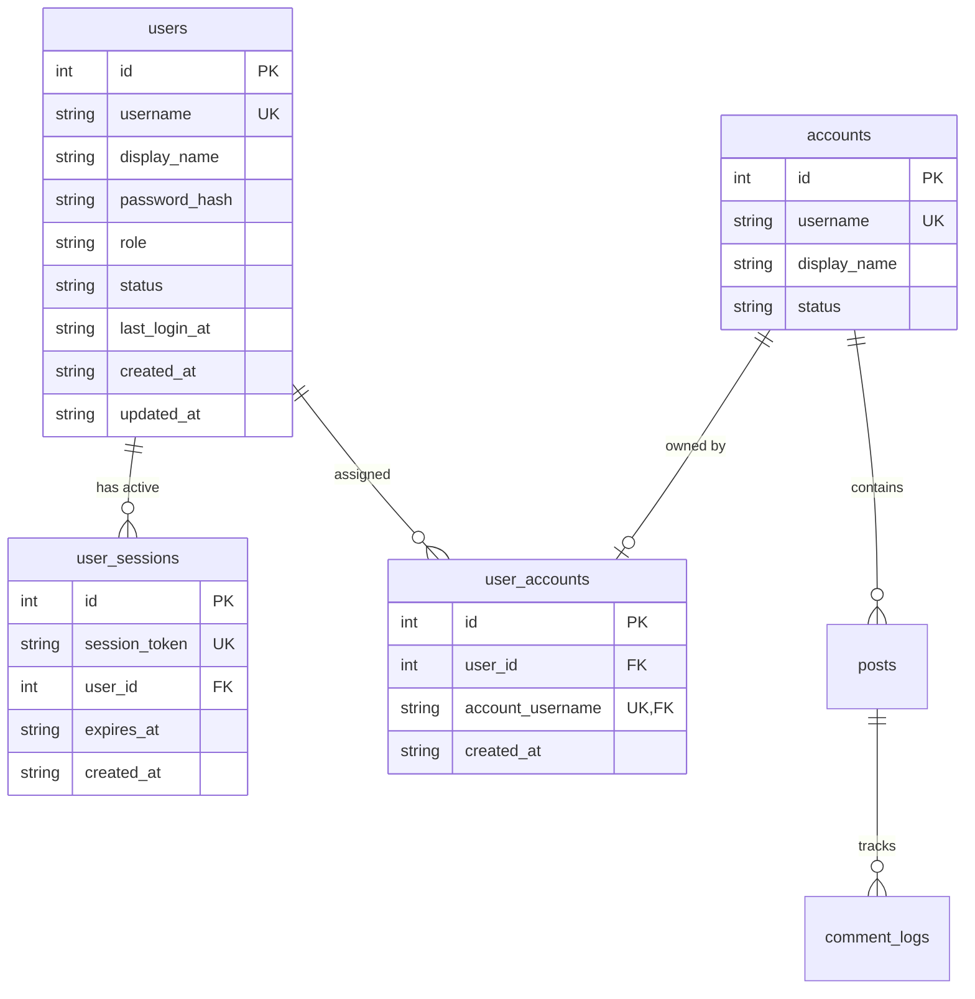
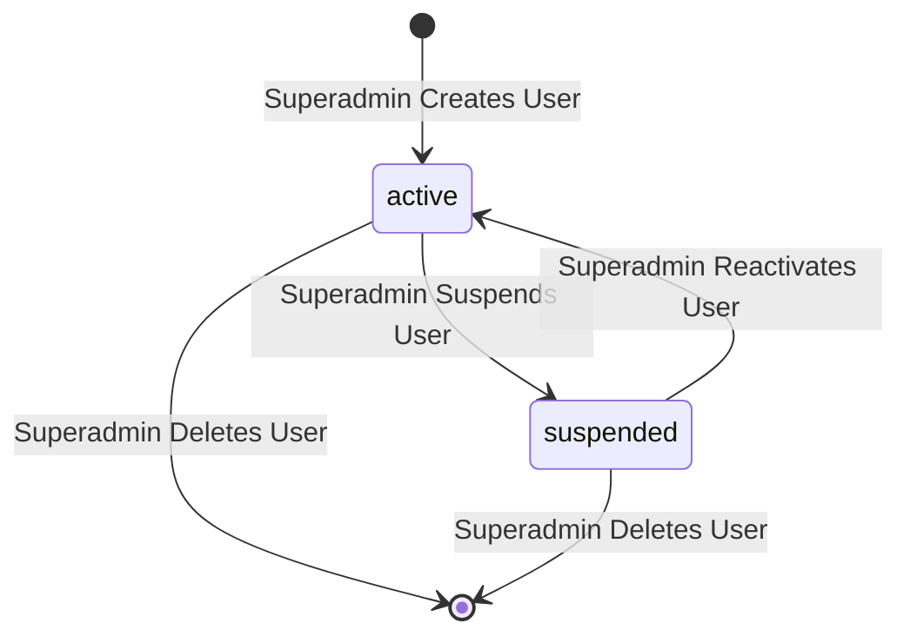
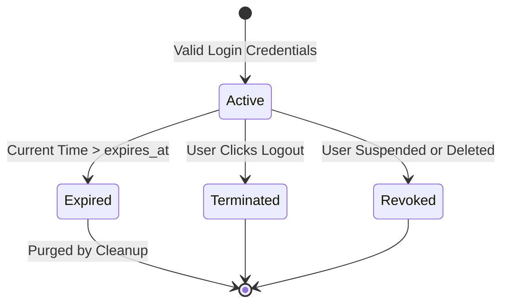

# Data Model: User Authentication and Multi-Account Assignment

**Feature**: `002-user-auth-assignment`
**Date**: 2026-10-18
**Database**: SQLite (`data/inflow.db` via `better-sqlite3`, WAL mode enabled)

---

## 1. Entity-Relationship Overview



---

## 2. Table Specifications

### 2.1 Table: `users`
Stores system operators, administrators, and tenant credentials.

```sql
CREATE TABLE IF NOT EXISTS users (
  id INTEGER PRIMARY KEY AUTOINCREMENT,
  username TEXT UNIQUE NOT NULL COLLATE NOCASE,
  display_name TEXT NOT NULL DEFAULT '',
  password_hash TEXT NOT NULL,
  role TEXT NOT NULL DEFAULT 'tenant' CHECK(role IN ('superadmin', 'tenant')),
  status TEXT NOT NULL DEFAULT 'active' CHECK(status IN ('active', 'suspended')),
  last_login_at TEXT,
  created_at TEXT NOT NULL,
  updated_at TEXT NOT NULL
);

CREATE UNIQUE INDEX IF NOT EXISTS idx_users_username ON users(username);
CREATE INDEX IF NOT EXISTS idx_users_status ON users(status);
```

#### Fields & Types
| Column | Type | Nullable | Default | Description |
| :--- | :--- | :---: | :--- | :--- |
| `id` | `INTEGER` | No | AUTOINCREMENT | Primary identifier |
| `username` | `TEXT` | No | - | Unique login username (case-insensitive via `NOCASE`) |
| `display_name` | `TEXT` | No | `''` | User's full or commercial name |
| `password_hash` | `TEXT` | No | - | Salted `scrypt` hash (`salt:derivedKeyHex`) |
| `role` | `TEXT` | No | `'tenant'` | Role: `'superadmin'` or `'tenant'` |
| `status` | `TEXT` | No | `'active'` | Account state: `'active'` or `'suspended'` |
| `last_login_at` | `TEXT` | Yes | `NULL` | ISO timestamp of most recent successful login |
| `created_at` | `TEXT` | No | - | ISO timestamp of record creation |
| `updated_at` | `TEXT` | No | - | ISO timestamp of last record update |

---

### 2.2 Table: `user_sessions`
Manages authenticated browser sessions and rapid revocation.

```sql
CREATE TABLE IF NOT EXISTS user_sessions (
  id INTEGER PRIMARY KEY AUTOINCREMENT,
  session_token TEXT UNIQUE NOT NULL,
  user_id INTEGER NOT NULL REFERENCES users(id) ON DELETE CASCADE,
  expires_at TEXT NOT NULL,
  created_at TEXT NOT NULL
);

CREATE UNIQUE INDEX IF NOT EXISTS idx_sessions_token ON user_sessions(session_token);
CREATE INDEX IF NOT EXISTS idx_sessions_user_id ON user_sessions(user_id);
CREATE INDEX IF NOT EXISTS idx_sessions_expires_at ON user_sessions(expires_at);
```

#### Fields & Types
| Column | Type | Nullable | Description |
| :--- | :--- | :---: | :--- |
| `id` | `INTEGER` | No | Primary identifier |
| `session_token` | `TEXT` | No | High-entropy crypto random token (32 bytes / 64 hex chars) |
| `user_id` | `INTEGER` | No | Foreign key referencing `users(id)` |
| `expires_at` | `TEXT` | No | ISO timestamp when the session expires (default: 7 days) |
| `created_at` | `TEXT` | No | ISO timestamp when the session was created |

---

### 2.3 Table: `user_accounts`
Enforces strict 1-to-N tenant account ownership in accordance with Constitution Principle VI.

```sql
CREATE TABLE IF NOT EXISTS user_accounts (
  id INTEGER PRIMARY KEY AUTOINCREMENT,
  user_id INTEGER NOT NULL REFERENCES users(id) ON DELETE CASCADE,
  account_username TEXT UNIQUE NOT NULL REFERENCES accounts(username) ON DELETE CASCADE,
  created_at TEXT NOT NULL
);

CREATE INDEX IF NOT EXISTS idx_user_accounts_user_id ON user_accounts(user_id);
CREATE UNIQUE INDEX IF NOT EXISTS idx_user_accounts_account ON user_accounts(account_username);
```

#### Integrity Invariant
- **1-to-N Constraint**: The `UNIQUE(account_username)` constraint guarantees that an Instagram account can belong to at most one user at any given time.
- A user may have 0, 1, or multiple rows in `user_accounts`.

---

## 3. State Transitions

### User Account Status


### Session Lifecycle


---

## 4. Seed Data & Initialization Logic

1. **Initial Admin Profile**:
   - When `users` table count is `0`, create:
     - `username`: `admin`
     - `display_name`: `Platform Administrator`
     - `role`: `superadmin`
     - `status`: `active`
     - `password_hash`: Scrypt hash of `process.env.INITIAL_ADMIN_PASSWORD || "Admin@inFlow2026!"`
2. **Default Account Assignment**:
   - Existing seed accounts (`r9spoort1`, `inflow.shop`) are automatically linked to `admin` in `user_accounts` so existing demo environments operate seamlessly.
