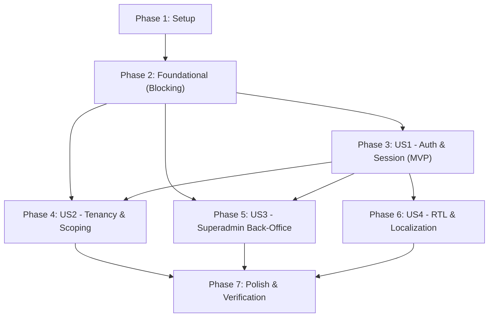

# Tasks: User Authentication and Multi-Account Assignment

**Feature**: `002-user-auth-assignment`
**Branch**: `002-user-auth-assignment`
**Spec**: [spec.md](file:///Users/mahdi.ketabdar/dev/inFlow/.specify/specs/002-user-auth-assignment/spec.md) | **Plan**: [plan.md](file:///Users/mahdi.ketabdar/dev/inFlow/.specify/specs/002-user-auth-assignment/plan.md)

---

## Phase 1: Setup (Shared Infrastructure)

**Purpose**: Environment and shared internationalization initialization.

- [X] T001 Configure session cookie secret and admin initial password environment variables in `.env.example`
- [X] T002 [P] Register internationalization dictionaries for authentication, tenancy, and back-office in `src/lib/i18n.ts`

---

## Phase 2: Foundational (Blocking Prerequisites)

**Purpose**: Core database schema, cryptographic hashing, and authorization guards that MUST be complete before ANY user story can proceed.

**⚠️ CRITICAL**: No user story implementation can begin until this phase is complete.

- [X] T003 Implement database schema migrations for `users`, `user_sessions`, and `user_accounts` tables in `src/lib/db.ts`
- [X] T004 Implement default Superadmin seeding and demo account assignment in `src/lib/db.ts`
- [X] T005 [P] Implement password hashing and verification using Node.js native `crypto.scrypt` in `src/lib/auth.ts`
- [X] T006 [P] Implement session token generation and cookie management utilities in `src/lib/auth.ts`
- [X] T007 Implement server-side session retrieval and authorization guard (`getSessionUser`, `requireAuth`, `requireSuperadmin`) in `src/lib/auth-guard.ts`

**Checkpoint**: Foundation ready — database schema, password hashing, and session validation ready for user story implementation.

---

## Phase 3: User Story 1 - User Authentication & Session Lifecycle (Priority: P1) 🎯 MVP

**Goal**: Provide secure credential login (username/password), session persistence via HTTP-only cookies, logout, and redirection of unauthenticated users away from protected areas.

**Independent Test**:
Can be fully tested by attempting to access protected dashboard routes unauthenticated (verifying redirection to `/login`), submitting valid credentials to land on the dashboard, and clicking logout to terminate the session.

### Implementation for User Story 1

- [X] T008 [P] [US1] Implement user login route handler `POST /api/auth/login` in `src/app/api/auth/login/route.ts`
- [X] T009 [P] [US1] Implement session termination route handler `POST /api/auth/logout` in `src/app/api/auth/logout/route.ts`
- [X] T010 [P] [US1] Implement current user profile route handler `GET /api/auth/me` in `src/app/api/auth/me/route.ts`
- [X] T011 [US1] Implement responsive login page with username/password form and error handling in `src/app/login/page.tsx`
- [X] T012 [US1] Integrate user session status, user role badge, and logout trigger into dashboard header in `src/components/inflow-dashboard.tsx`
- [X] T013 [US1] Implement route authentication guard on root dashboard page to redirect unauthenticated visitors to `/login` in `src/app/page.tsx`

**Checkpoint**: User Story 1 is fully functional as an MVP. Users can log in, view their session state, log out, and unauthorized users are protected by login redirection.

---

## Phase 4: User Story 2 - Multi-Account Tenancy & Scoped Dashboard (Priority: P1)

**Goal**: Strictly isolate tenant access so standard users view and configure only their assigned Instagram accounts, with zero cross-tenant data leakage.

**Independent Test**:
Create Tenant A assigned to `@r9spoort1` and Tenant B assigned to `@inflow.shop`. Verify that Tenant A only sees `@r9spoort1` in their account dropdown, and direct requests to `@inflow.shop` respond with 403 Forbidden.

### Implementation for User Story 2

- [X] T014 [P] [US2] Update `GET /api/accounts` with tenancy filtering based on authenticated user role and assignments in `src/app/api/accounts/route.ts`
- [X] T015 [P] [US2] Add tenancy ownership verification to `GET /api/posts` in `src/app/api/posts/route.ts`
- [X] T016 [P] [US2] Add tenancy ownership verification to `PATCH /api/posts/[shortcode]` in `src/app/api/posts/[shortcode]/route.ts`
- [X] T017 [P] [US2] Add tenancy ownership verification to `POST /api/sync` in `src/app/api/sync/route.ts`
- [X] T018 [US2] Update account selector in `src/components/inflow-dashboard.tsx` to display only authorized accounts for the active session
- [X] T019 [US2] Implement empty-state component for tenant users with zero assigned Instagram accounts in `src/components/empty-tenancy-view.tsx`

**Checkpoint**: User Story 2 complete. Tenancy boundaries are enforced on both server endpoints and UI selectors.

---

## Phase 5: User Story 3 - Superadmin Back-Office & Account Assignment (Priority: P2)

**Goal**: Provide a dedicated administrative portal at `/backoffice` for superadmins to manage users, toggle account statuses, and assign/unassign Instagram accounts.

**Independent Test**:
Log in as `admin`, navigate to `/backoffice`, create a new tenant user, assign an Instagram account, log in as that tenant, and confirm access to that account.

### Implementation for User Story 3

- [X] T020 [P] [US3] Implement user listing and creation route handlers `GET /api/backoffice/users` and `POST /api/backoffice/users` in `src/app/api/backoffice/users/route.ts`
- [X] T021 [P] [US3] Implement user update and deletion route handlers `PATCH /api/backoffice/users/[id]` and `DELETE /api/backoffice/users/[id]` in `src/app/api/backoffice/users/[id]/route.ts`
- [X] T022 [P] [US3] Implement account assignment route handler `POST /api/backoffice/users/[id]/assignments` in `src/app/api/backoffice/users/[id]/assignments/route.ts`
- [X] T023 [P] [US3] Create user management directory table component in `src/components/backoffice/user-table.tsx`
- [X] T024 [P] [US3] Create user creation dialog modal component in `src/components/backoffice/create-user-modal.tsx`
- [X] T025 [P] [US3] Create account assignment dialog modal component in `src/components/backoffice/assign-accounts-modal.tsx`
- [X] T026 [US3] Implement Back-Office administrative portal page with superadmin role guard in `src/app/backoffice/page.tsx`
- [X] T027 [US3] Add Back-Office portal link button in dashboard header for superadmins in `src/components/inflow-dashboard.tsx`

**Checkpoint**: User Story 3 complete. Superadmins can manage all tenant accounts and assignments via a dedicated Back-Office UI.

---

## Phase 6: User Story 4 - Multi-Language & RTL Authentication Experience (Priority: P3)

**Goal**: Deliver a polished bidirectional experience with Persian, Arabic, and English support, RTL alignment, and Vazirmatn typography across auth and admin screens.

**Independent Test**:
Switch the language between Persian, Arabic, and English on the login and Back-Office views; verify all labels, validation alerts, and form fields adjust direction and typography accurately.

### Implementation for User Story 4

- [X] T028 [P] [US4] Add language selector switcher component to login page in `src/app/login/page.tsx`
- [X] T029 [P] [US4] Ensure RTL layout direction (`dir="rtl"`) and Vazirmatn font styling apply to Back-Office views in `src/app/backoffice/page.tsx`
- [X] T030 [US4] Verify and align bidirectional typography, error notices, and action buttons in `src/lib/i18n.ts`

**Checkpoint**: User Story 4 complete. Full RTL/LTR linguistic parity across Persian, Arabic, and English.

---

## Phase 7: Polish & Cross-Cutting Concerns

**Purpose**: Documentation updates and end-to-end verification.

- [X] T031 [P] Update developer documentation and API reference in `AGENTS.md`
- [X] T032 Execute end-to-end verification scenarios per `quickstart.md` and validate clean build with `pnpm build`

---

## Dependencies & Execution Order

### Phase Dependencies



### User Story Dependencies

- **User Story 1 (P1)**: Depends on Foundational (Phase 2). Establishes login, session cookies, and user header.
- **User Story 2 (P1)**: Depends on User Story 1 (requires logged-in user context to scope accounts).
- **User Story 3 (P2)**: Depends on User Story 1 (requires `superadmin` session to access Back-Office).
- **User Story 4 (P3)**: Enhances views built in US1 and US3 with RTL language switching and styling.

---

## Parallel Opportunities

### Foundational Tasks (Phase 2)
```bash
# Can run concurrently once schema migrations are in place:
T005: "Implement password hashing in src/lib/auth.ts"
T006: "Implement session token generation in src/lib/auth.ts"
```

### User Story 1 Tasks (Phase 3)
```bash
# Route handlers can be authored concurrently:
T008: "POST /api/auth/login in src/app/api/auth/login/route.ts"
T009: "POST /api/auth/logout in src/app/api/auth/logout/route.ts"
T010: "GET /api/auth/me in src/app/api/auth/me/route.ts"
```

### User Story 2 Tasks (Phase 4)
```bash
# Tenancy protection on existing API endpoints can be authored concurrently:
T014: "GET /api/accounts tenancy filter in src/app/api/accounts/route.ts"
T015: "GET /api/posts tenancy verification in src/app/api/posts/route.ts"
T016: "PATCH /api/posts/[shortcode] tenancy verification in src/app/api/posts/[shortcode]/route.ts"
T017: "POST /api/sync tenancy verification in src/app/api/sync/route.ts"
```

### User Story 3 Tasks (Phase 5)
```bash
# Back-office API routes and UI components can run in parallel:
T020: "User CRUD routes in src/app/api/backoffice/users/route.ts"
T021: "User edit/delete routes in src/app/api/backoffice/users/[id]/route.ts"
T022: "Assignment route in src/app/api/backoffice/users/[id]/assignments/route.ts"
T023: "UserTable component in src/components/backoffice/user-table.tsx"
T024: "CreateUserModal component in src/components/backoffice/create-user-modal.tsx"
T025: "AssignAccountsModal component in src/components/backoffice/assign-accounts-modal.tsx"
```

---

## Implementation Strategy

### MVP First (User Story 1 Only)
1. Complete **Phase 1: Setup** (`T001` - `T002`)
2. Complete **Phase 2: Foundational** (`T003` - `T007`)
3. Complete **Phase 3: User Story 1** (`T008` - `T013`)
4. **VALIDATE MVP**: Access dashboard unauthenticated (redirects to `/login`), log in as `admin`, verify header and logout.

### Incremental Delivery
1. Foundation + US1 → Working authentication & session protection (MVP).
2. Add US2 → Multi-account tenancy isolation and protection on all data routes.
3. Add US3 → Back-Office management plane for dynamic tenant user creation and account assignment.
4. Add US4 → Polished RTL bidirectional experience for Persian, Arabic, and English.
5. Final Polish → Documentation updates and full build verification (`pnpm build`).
