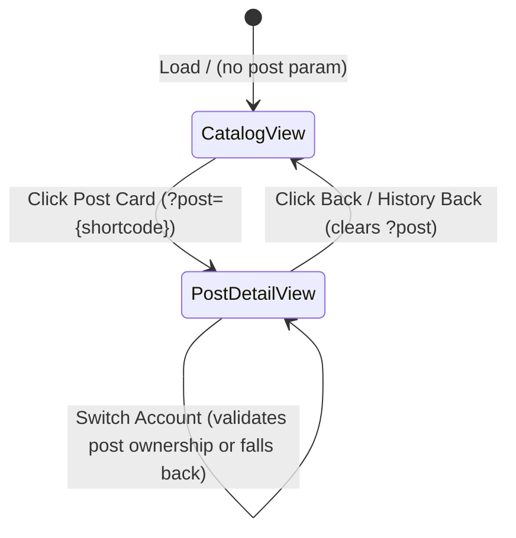

# Data Model & State Schema: Feature 004

**Feature**: Sidebar Navigation, Topbar Decluttering & Deep Linking
**Branch**: `004-sidebar-nav-deep-linking`
**Date**: 2026-10-18

## 1. URL Navigation & Deep-Link State Schema

URL query parameters serve as the single source of truth for post selection and browser history persistence.

```typescript
export interface DashboardUrlParams {
  /**
   * The shortcode of the currently selected Instagram post or reel.
   * When present, the dashboard renders the PostDetailView for this post.
   * When omitted or empty, the dashboard renders the catalog list.
   * Example: ?post=DehQhnjoEcr
   */
  post?: string;

  /**
   * The currently active Instagram account username.
   * Example: ?account=r9spoort1
   */
  account?: string;
}
```

### URL State Transitions



---

## 2. Navigation Item Interface

```typescript
export interface NavItem {
  id: string;
  label: string;
  icon: React.ComponentType<{ className?: string }>;
  href?: string;
  onClick?: () => void;
  isActive?: boolean;
  badge?: React.ReactNode;
  variant?: "default" | "ghost" | "destructive" | "highlight";
}
```

---

## 3. Language & Locale Configuration

```typescript
export type Lang = "fa" | "ar" | "en";

export interface LanguageOption {
  code: Lang;
  label: string;
  nativeLabel: string;
  dir: "rtl" | "ltr";
}

export const SUPPORTED_LANGUAGES: LanguageOption[] = [
  { code: "fa", label: "فارسی", nativeLabel: "فارسی", dir: "rtl" },
  { code: "ar", label: "العربية", nativeLabel: "العربية", dir: "rtl" },
  { code: "en", label: "English", nativeLabel: "English", dir: "ltr" },
];
```

---

## 4. UI Layout & View State

```typescript
export interface DashboardLayoutState {
  /**
   * Mobile slide-over drawer visibility state.
   */
  mobileDrawerOpen: boolean;

  /**
   * Content view presentation mode.
   * Relocated to the content toolbar.
   */
  viewMode: "cards" | "grid";

  /**
   * Filter tab for post catalog.
   */
  filterTab: "all" | "active" | "inactive" | "reels" | "posts";

  /**
   * Search query text filtering posts by code, caption, or rules.
   */
  searchQuery: string;
}
```
