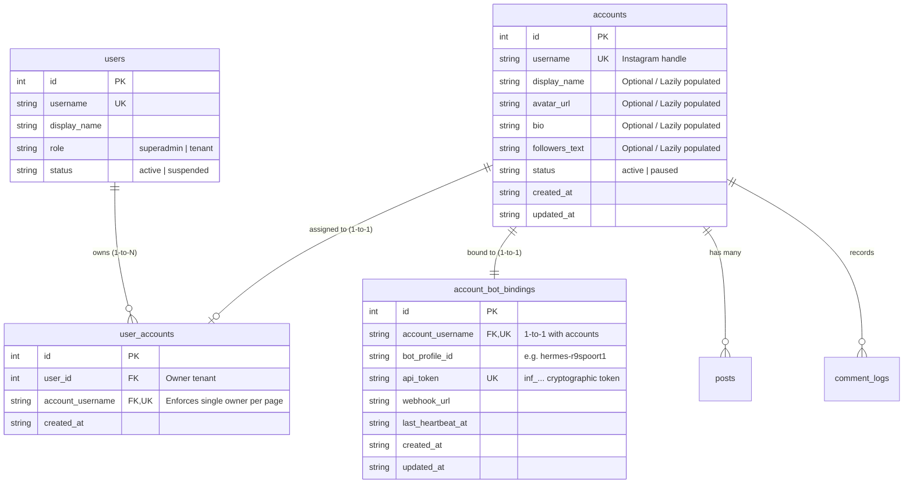
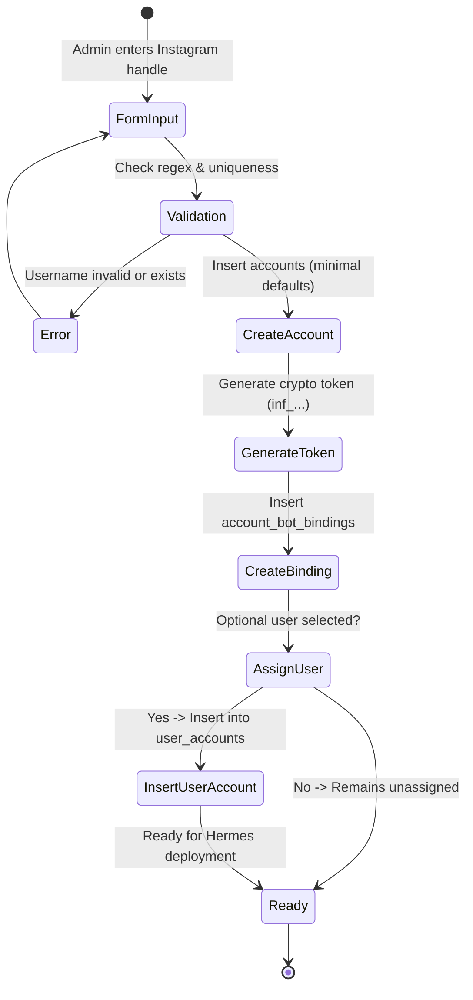

# Data Model & Schema Specification: Admin Page Management & Per-Page MCP Tokens

**Feature Branch**: `006-admin-page-mcp-tokens`
**Status**: Ready for Planning

## Entity Relationship Overview

---

## Detailed Entity Definitions

### 1. `accounts` (Minimalist Page Entity)

Represents an Instagram page registered in inFlow.

| Field | Type | Constraints | Description |
| :--- | :--- | :--- | :--- |
| `id` | `INTEGER` | `PRIMARY KEY AUTOINCREMENT` | Internal database surrogate key. |
| `username` | `TEXT` | `UNIQUE NOT NULL` | Instagram username/handle without `@` (e.g. `r9spoort1`). Validated: alphanumeric + dots/underscores, 1-30 chars. |
| `display_name` | `TEXT` | `NOT NULL DEFAULT ''` | Display name of the page. Default empty string; lazily updated by worker agent. |
| `avatar_url` | `TEXT` | `NOT NULL DEFAULT ''` | Profile image URL. Default empty string; lazily updated by worker agent. |
| `bio` | `TEXT` | `NOT NULL DEFAULT ''` | Instagram bio text. Default empty string; lazily updated by worker agent. |
| `followers_text` | `TEXT` | `DEFAULT NULL` | Human-readable followers count (e.g. `42.8K`). Lazily updated by worker agent. |
| `posts_count` | `INTEGER` | `DEFAULT 0` | Total cached posts/reels count. |
| `status` | `TEXT` | `NOT NULL DEFAULT 'active'` | Operational status: `'active'` \| `'paused'`. |
| `agent_interval_sec` | `INTEGER` | `NOT NULL DEFAULT 120` | Hermes polling interval in seconds (default 2 minutes). |
| `last_heartbeat_at` | `TEXT` | `DEFAULT NULL` | ISO timestamp of the latest interaction from the agent. |
| `created_at` | `TEXT` | `NOT NULL` | ISO timestamp when the page was created. |
| `updated_at` | `TEXT` | `NOT NULL` | ISO timestamp of latest metadata update. |

---

### 2. `account_bot_bindings` (Per-Page Execution Token & Hermes Profile)

Maintains the strict 1-to-1 association between an Instagram page and its dedicated Hermes execution worker.

| Field | Type | Constraints | Description |
| :--- | :--- | :--- | :--- |
| `id` | `INTEGER` | `PRIMARY KEY AUTOINCREMENT` | Internal database surrogate key. |
| `account_username` | `TEXT` | `UNIQUE NOT NULL REFERENCES accounts(username) ON DELETE CASCADE` | The Instagram handle bound to this bot profile. |
| `bot_profile_id` | `TEXT` | `NOT NULL` | Dedicated profile identifier on the server (e.g. `hermes-r9spoort1`). |
| `api_token` | `TEXT` | `UNIQUE NOT NULL` | Cryptographically random Bearer token (`inf_` + 48 hex characters). Used for all inbound REST and MCP authentication. |
| `webhook_url` | `TEXT` | `DEFAULT NULL` | Optional outbound webhook endpoint for real-time dispatching. |
| `last_heartbeat_at` | `TEXT` | `DEFAULT NULL` | ISO timestamp when the bot authenticated or polled. |
| `created_at` | `TEXT` | `NOT NULL` | ISO timestamp when the token was created. |
| `updated_at` | `TEXT` | `NOT NULL` | ISO timestamp when the token was last regenerated. |

---

### 3. `user_accounts` (1-to-N Tenancy Ownership)

Enforces Constitution Principle VI: one user can own multiple pages, but each page is owned by at most one user.

| Field | Type | Constraints | Description |
| :--- | :--- | :--- | :--- |
| `id` | `INTEGER` | `PRIMARY KEY AUTOINCREMENT` | Internal surrogate key. |
| `user_id` | `INTEGER` | `NOT NULL REFERENCES users(id) ON DELETE CASCADE` | The platform user who manages this page. |
| `account_username` | `TEXT` | `UNIQUE NOT NULL REFERENCES accounts(username) ON DELETE CASCADE` | Target page. Unique constraint guarantees exclusive single ownership. |
| `created_at` | `TEXT` | `NOT NULL` | ISO timestamp of assignment. |

---

## State Transitions & Validation Rules

### Minimalist Page Creation Workflow

### Token Lifecycle & Invalidation

1. **Initial Provisioning**:
   - Token is generated with format: `'inf_' + crypto.randomBytes(24).toString('hex')`.
   - Stored in plaintext (or salt-hashed if verification-only; stored in reversible/accessible form for Superadmin display in Back-Office).
2. **Rotation (Regenerate Token)**:
   - Superadmin confirms token rotation in Back-Office modal.
   - `UPDATE account_bot_bindings SET api_token = ?, updated_at = ? WHERE account_username = ?`.
   - Immediately revokes the old token. Any running agent with the old token gets HTTP 401 on its next request.
3. **Lazy Profile Metadata Enrichment**:
   - When the agent with a valid token calls `POST /api/sync` or profile update:
   - `UPDATE accounts SET display_name = COALESCE(?, display_name), avatar_url = COALESCE(?, avatar_url), bio = COALESCE(?, bio), followers_text = COALESCE(?, followers_text), updated_at = ? WHERE username = ?`.
