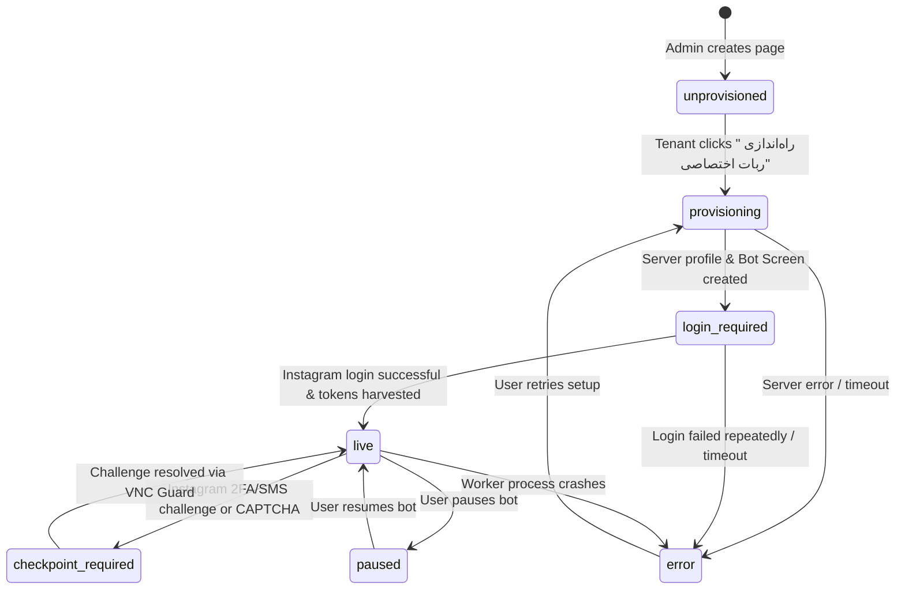

# Data Model: Dedicated Bot Provisioning, Lifecycle & VNC Guard

This document defines the data schema, entity relationships, validation rules, and state machine transitions for feature `007-bot-provisioning-and-vnc-guard`.

---

## 1. Entity Definitions

### 1.1 `accounts` (Table Schema Modifications)

The existing `accounts` table in `data/inflow.db` is augmented with dedicated bot lifecycle and VNC session tracking columns:

| Column Name | SQLite Type | Nullable | Default | Description |
| :--- | :--- | :--- | :--- | :--- |
| `bot_profile_name` | `TEXT` | YES | `NULL` | Name of the isolated Hermes profile (e.g. `inflow_r9spoort1`). |
| `bot_status` | `TEXT` | NO | `'unprovisioned'` | Current lifecycle state of the dedicated bot. |
| `bot_vnc_active` | `INTEGER` | NO | `0` | `1` if a VNC Guard session is currently open, `0` if closed. |
| `bot_vnc_token` | `TEXT` | YES | `NULL` | Cryptographically random one-time token for noVNC access. |
| `bot_vnc_expires_at` | `TEXT` | YES | `NULL` | ISO-8601 timestamp when the active VNC session expires. |
| `bot_last_error` | `TEXT` | YES | `NULL` | Human-readable explanation of error or checkpoint. |

#### SQL Migration Script
```sql
ALTER TABLE accounts ADD COLUMN bot_profile_name TEXT DEFAULT NULL;
ALTER TABLE accounts ADD COLUMN bot_status TEXT NOT NULL DEFAULT 'unprovisioned';
ALTER TABLE accounts ADD COLUMN bot_vnc_active INTEGER NOT NULL DEFAULT 0;
ALTER TABLE accounts ADD COLUMN bot_vnc_token TEXT DEFAULT NULL;
ALTER TABLE accounts ADD COLUMN bot_vnc_expires_at TEXT DEFAULT NULL;
ALTER TABLE accounts ADD COLUMN bot_last_error TEXT DEFAULT NULL;

CREATE INDEX IF NOT EXISTS idx_accounts_bot_status ON accounts(bot_status);
```

---

### 1.2 `bot_lifecycle_logs` (New Audit & Timeline Table)

Stores historical state transitions, errors, and system events for each dedicated bot profile.

| Column Name | SQLite Type | Nullable | Default | Description |
| :--- | :--- | :--- | :--- | :--- |
| `id` | `INTEGER PRIMARY KEY AUTOINCREMENT` | NO | - | Unique log entry identifier. |
| `account_username` | `TEXT` | NO | - | Foreign key referencing `accounts.username`. |
| `from_status` | `TEXT` | YES | `NULL` | Previous state before the transition. |
| `to_status` | `TEXT` | NO | - | New state after the transition. |
| `message` | `TEXT` | NO | - | Descriptive event message or error details. |
| `actor` | `TEXT` | NO | `'system'` | Triggering entity (`'user'`, `'system'`, `'agent'`). |
| `created_at` | `TEXT` | NO | `datetime('now')` | ISO-8601 timestamp of the event. |

#### SQL Migration Script
```sql
CREATE TABLE IF NOT EXISTS bot_lifecycle_logs (
    id INTEGER PRIMARY KEY AUTOINCREMENT,
    account_username TEXT NOT NULL REFERENCES accounts(username) ON DELETE CASCADE,
    from_status TEXT,
    to_status TEXT NOT NULL,
    message TEXT NOT NULL,
    actor TEXT NOT NULL DEFAULT 'system',
    created_at TEXT NOT NULL DEFAULT (datetime('now'))
);

CREATE INDEX IF NOT EXISTS idx_bot_logs_account ON bot_lifecycle_logs(account_username, created_at DESC);
```

---

## 2. State Machine: Bot Lifecycle Transitions

The bot lifecycle follows a deterministic finite state machine (FSM):



### Transition Rules & Permissions

| From State | Event / Trigger | To State | Initiator | Action Taken |
| :--- | :--- | :--- | :--- | :--- |
| `unprovisioned` | Provision Trigger | `provisioning` | Tenant / Admin | Calls orchestrator to create `inflow_<username>` profile. |
| `provisioning` | Profile & Screen Ready | `login_required` | Server Orchestrator | Launches Chrome to Instagram login, starts VNC Guard. |
| `provisioning` | Orchestrator Error | `error` | Server Orchestrator | Logs error details in `bot_lifecycle_logs`. |
| `login_required` | Session Harvested | `live` | Worker / Orchestrator | Captures cookies, verifies API access, terminates VNC stream. |
| `live` | Checkpoint Detected | `checkpoint_required` | Worker Agent | Flags account, prompts user to resolve in browser via VNC. |
| `checkpoint_required` | Challenge Cleared | `live` | Worker / Tenant | Re-verifies session and resumes polling. |
| `live` | Pause Action | `paused` | Tenant / Admin | Halts background polling cycle. |
| `paused` | Resume Action | `live` | Tenant / Admin | Resumes background polling cycle. |

---

## 3. VNC Guard Session Model

An ephemeral session is represented in `accounts`:
- **Active Window**: `bot_vnc_active = 1`
- **Token Validity**: `bot_vnc_token` is a 16-character hex string generated via `crypto.randomBytes(8).toString('hex')`.
- **Expiration**: `bot_vnc_expires_at` is set to `now + 600 seconds` (10 minutes).
- **Cleanup Rule**: Any request checking VNC status where `bot_vnc_expires_at < now` automatically updates `bot_vnc_active = 0`, clears the token, and calls the stop handler.
