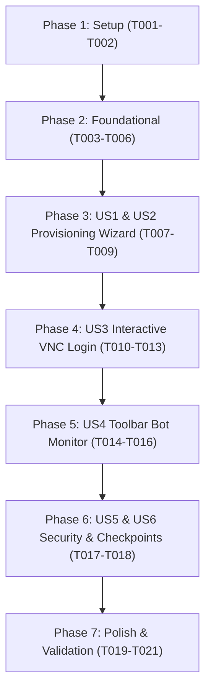

# Implementation Tasks: Dedicated Bot Provisioning, Lifecycle Management & On-Demand VNC Guard

**Feature**: Dedicated Bot Provisioning, Lifecycle Management & On-Demand VNC Guard
**Branch**: `007-bot-provisioning-and-vnc-guard`
**Spec**: [.specify/specs/007-bot-provisioning-and-vnc-guard/spec.md](file:///Users/mahdi.ketabdar/dev/inFlow/.specify/specs/007-bot-provisioning-and-vnc-guard/spec.md)
**Plan**: [.specify/specs/007-bot-provisioning-and-vnc-guard/plan.md](file:///Users/mahdi.ketabdar/dev/inFlow/.specify/specs/007-bot-provisioning-and-vnc-guard/plan.md)

---

## Phase 1: Setup (Shared Infrastructure)

**Purpose**: Database schema expansion, audit tables, and internationalization dictionaries

- [X] T001 Register database schema migrations for bot columns in `accounts` table and create `bot_lifecycle_logs` in `src/lib/db.ts`
- [X] T002 [P] Register Persian and English internationalization dictionary strings for bot statuses, setup wizard, VNC viewer, and monitor drawer in `src/lib/i18n.ts`

---

## Phase 2: Foundational (Blocking Prerequisites)

**Purpose**: Core orchestration drivers, IPC scripts, and bot telemetry endpoints that all user stories depend on

**⚠️ CRITICAL**: No user story work can begin until this phase is complete

- [X] T003 Implement the Server Orchestrator driver with local, remote, and simulated execution modes in `src/lib/server-orchestrator.ts`
- [X] T004 [P] Implement the Python Server Orchestrator CLI for profile management and VNC Guard in `scripts/hermes_orchestrator.py`
- [X] T005 [P] Implement the Bot Status API route with tenancy verification and auto-cleanup of expired VNC tokens in `src/app/api/bot/status/route.ts`
- [X] T006 [P] Implement the Bot State transition route supporting pause, resume, and retry actions in `src/app/api/bot/state/route.ts`

**Checkpoint**: Foundation ready - user story implementation can now begin.

---

## Phase 3: User Story 1 & 2 - Self-Service Bot Provisioning Wizard & Pipeline (Priority: P1) 🎯 MVP

**Goal**: Enable tenant users to initiate dedicated Hermes profile creation from an intuitive, reassuring onboarding wizard for unprovisioned accounts.

**Independent Test**: Register an unprovisioned test account, log in as tenant, confirm the `BotSetupWizard` is displayed with Persian security reassurances, click "راه‌اندازی ربات اختصاصی", and verify the transition to `provisioning` and `login_required` states.

### Implementation for User Story 1 & 2

- [X] T007 [US1] Implement the Bot Provisioning API endpoint in `src/app/api/bot/provision/route.ts`
- [X] T008 [P] [US1] Create the `BotSetupWizard` component with 3-step visual progress bar and security reassurance card in `src/components/bot/bot-setup-wizard.tsx`
- [X] T009 [US1] Integrate `BotSetupWizard` into `src/components/inflow-dashboard.tsx` to conditionally render when `bot_status` is `unprovisioned` or `provisioning`

**Checkpoint**: At this point, User Story 1 & 2 provide a working MVP for account onboarding and profile provisioning.

---

## Phase 4: User Story 3 - Interactive Instagram Login & On-Demand VNC Guard (Priority: P1)

**Goal**: Allow tenants to securely open the dedicated headed Chrome browser inside a modal to log into Instagram with 2FA/SMS, harvest session cookies, and transition to `live` status.

**Independent Test**: Trigger "ورود به اینستاگرام در مرورگر" from the wizard, verify that `POST /api/bot/vnc-session` opens the `VncViewerModal` with an embedded noVNC view and a 10-minute countdown timer, verify that session harvesting marks the bot `live`, and confirm the VNC session closes.

### Implementation for User Story 3

- [X] T010 [US3] Implement on-demand VNC session generation (POST) and termination (DELETE) API in `src/app/api/bot/vnc-session/route.ts`
- [X] T011 [US3] Implement Session Harvested verification callback endpoint in `src/app/api/bot/session-harvested/route.ts`
- [X] T012 [P] [US3] Create `VncViewerModal` component with embedded noVNC iframe, 10-minute live countdown timer, and disconnect button in `src/components/bot/vnc-viewer-modal.tsx`
- [X] T013 [US3] Connect `VncViewerModal` to `BotSetupWizard` step 2 to allow interactive Instagram authentication in `src/components/bot/bot-setup-wizard.tsx`

**Checkpoint**: User Stories 1, 2, and 3 enable complete end-to-end onboarding and authentic Instagram login.

---

## Phase 5: User Story 4 - Persistent Top-Toolbar Bot Monitor & Remote Drawer (Priority: P1)

**Goal**: Provide a permanent Bot Status indicator in the top navbar with dynamic badges and a slide-over drawer for telemetry, logs, pause/resume, and live browser access.

**Independent Test**: Verify that the top navbar always displays the Bot status badge with correct colors (Green = Live, Yellow = Login Required, Blue = Provisioning, Red = Error), click to open `BotMonitorDrawer`, and launch an on-demand VNC session.

### Implementation for User Story 4

- [X] T014 [P] [US4] Create `BotMonitorDrawer` component displaying real-time uptime, last heartbeat, profile name, and action triggers in `src/components/bot/bot-monitor-drawer.tsx`
- [X] T015 [P] [US4] Create `BotToolbarButton` component with dynamic color-coded badges and click handler in `src/components/bot/bot-toolbar-button.tsx`
- [X] T016 [US4] Integrate `BotToolbarButton` and `BotMonitorDrawer` into the top navigation bar of `src/components/inflow-dashboard.tsx`

**Checkpoint**: User Stories 1 through 4 provide full continuous monitoring and management.

---

## Phase 6: User Story 5 & 6 - Security Hardening & Checkpoint Recovery (Priority: P2)

**Goal**: Ensure zero technical leakage of internal server tokens or paths, and provide a streamlined recovery flow when Instagram triggers checkpoints.

**Independent Test**: Verify that all tenant API responses contain only high-level status data with no server filesystem paths, and simulate a `checkpoint_required` event to confirm that the UI alerts the tenant with a direct action to resolve the challenge.

### Implementation for User Story 5 & 6

- [X] T017 [P] [US5] Implement strict tenant response filtering in `src/lib/server-orchestrator.ts` and `src/app/api/bot/*` routes to sanitize technical server paths
- [X] T018 [US6] Add Checkpoint alert banner and direct VNC challenge resolution action in `src/components/inflow-dashboard.tsx` and `src/components/bot/bot-monitor-drawer.tsx`

---

## Phase 7: Polish & Validation

**Purpose**: Agent worker synchronization, documentation updates, and end-to-end verification

- [X] T019 [P] Update `scripts/hermes_worker.py` to update bot heartbeat and respect `paused` status
- [X] T020 Update `AGENTS.md` and project documentation to document the new bot lifecycle and orchestrator CLI commands
- [X] T021 Execute validation scenarios from `quickstart.md` and verify complete flow across all user stories

---

## Dependencies & Execution Order

### Phase Dependencies

### Parallel Opportunities

- **Phase 1**: `T002` (i18n) can run in parallel with `T001` (DB schema).
- **Phase 2**: `T004` (Python orchestrator), `T005` (Status route), and `T006` (State route) can run in parallel after `T003`.
- **Phase 3**: `T008` (`BotSetupWizard` UI) can run in parallel with `T007` (Provisioning API).
- **Phase 4**: `T012` (`VncViewerModal` UI) can run in parallel with `T010` (VNC API) and `T011` (Harvested API).
- **Phase 5**: `T014` (`BotMonitorDrawer`) and `T015` (`BotToolbarButton`) can be implemented in parallel before `T016`.
- **Phase 6 & 7**: `T017`, `T019`, and `T020` can run in parallel.

---

## Implementation Strategy

### MVP Scope (Phase 1 to Phase 3)
1. Complete DB schema & i18n (`T001`, `T002`).
2. Complete Foundational orchestrator driver & endpoints (`T003` - `T006`).
3. Complete `BotSetupWizard` and provisioning API (`T007` - `T009`).
4. **MVP Result**: When a tenant selects an unprovisioned account, they see the setup wizard with security assurances and can click to provision the dedicated Hermes profile on the server.

### Incremental Delivery
- **Increment 2 (Phase 4)**: Adds interactive VNC Guard login and automatic transition to `live`.
- **Increment 3 (Phase 5)**: Adds permanent top toolbar indicator and monitor drawer.
- **Increment 4 (Phase 6 & 7)**: Adds checkpoint recovery, security hardening, and worker heartbeat sync.
