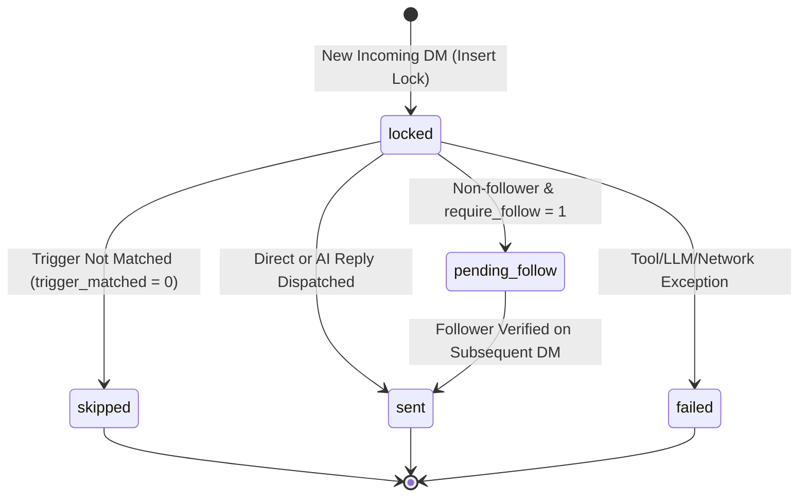

# Data Model: Direct Message (DM) Automation Plugin

**Feature**: `011-dm-automation-plugin`  
**Date**: 2026-10-20  
**Status**: Ready for Implementation

This document defines the schema, relations, validation constraints, and lifecycle states for Direct Message (DM) Automation in inFlow (`data/inflow.db`).

---

## 1. Table Definitions

### 1.1 `dm_automations` (Per-Account DM Configuration)

Stores the active configuration, triggers, knowledge sources, prompt rules, and master switch for an Instagram account's direct message automation.

| Column Name | SQLite Type | Nullable | Default | Description |
| :--- | :--- | :--- | :--- | :--- |
| `id` | `INTEGER PRIMARY KEY AUTOINCREMENT` | NO | - | Internal unique identifier |
| `account_username` | `TEXT UNIQUE` | NO | - | Foreign key referencing `accounts(username)` ON DELETE CASCADE |
| `enabled` | `INTEGER` | NO | `0` | Master toggle: `1` = Active, `0` = Paused / Disabled |
| `trigger_type` | `TEXT` | NO | `'all'` | Trigger matching evaluation mode: `'all'`, `'keywords'`, or `'ai_context'` |
| `trigger_context` | `TEXT` | NO | `''` | Natural language semantic condition for AI intent matching |
| `trigger_keywords` | `TEXT` | NO | `''` | Comma-separated list of keywords for keyword trigger mode |
| `reply_mode` | `TEXT` | NO | `'direct'` | Reply generation mode: `'direct'` (static text) or `'ai'` (LLM response) |
| `direct_reply_text` | `TEXT` | NO | `''` | Fixed static response message for direct mode |
| `ai_prompt_instructions` | `TEXT` | NO | `''` | Master prompt, persona, business rules, and guidelines for AI |
| `web_context_urls` | `TEXT` | NO | `'[]'` | JSON array of website URLs to scrape for live product/store data |
| `mcp_servers_config` | `TEXT` | NO | `'[]'` | JSON array of enabled MCP server identifiers (e.g. `["maghzook"]`) |
| `require_follow` | `INTEGER` | NO | `0` | `1` = Require sender to follow account before replying, `0` = Allow all |
| `follow_prompt_text` | `TEXT` | NO | `'سلام! برای دریافت پاسخ، لطفاً ابتدا پیج را فالو کنید 🙏'` | Message sent to non-followers when follow-gating is active |
| `story_handling_mode` | `TEXT` | NO | `'auto'` | Handling mode for story replies (`'auto'` injects story text, `'ignore'`) |
| `updated_at` | `TEXT` | NO | `(datetime('now'))` | ISO timestamp of last configuration update |
| `created_at` | `TEXT` | NO | `(datetime('now'))` | ISO timestamp of record creation |

#### SQL Migration Script
```sql
CREATE TABLE IF NOT EXISTS dm_automations (
    id INTEGER PRIMARY KEY AUTOINCREMENT,
    account_username TEXT UNIQUE NOT NULL REFERENCES accounts(username) ON DELETE CASCADE,
    enabled INTEGER NOT NULL DEFAULT 0,
    trigger_type TEXT NOT NULL DEFAULT 'all' CHECK (trigger_type IN ('all', 'keywords', 'ai_context')),
    trigger_context TEXT NOT NULL DEFAULT '',
    trigger_keywords TEXT NOT NULL DEFAULT '',
    reply_mode TEXT NOT NULL DEFAULT 'direct' CHECK (reply_mode IN ('direct', 'ai')),
    direct_reply_text TEXT NOT NULL DEFAULT '',
    ai_prompt_instructions TEXT NOT NULL DEFAULT '',
    web_context_urls TEXT NOT NULL DEFAULT '[]',
    mcp_servers_config TEXT NOT NULL DEFAULT '[]',
    require_follow INTEGER NOT NULL DEFAULT 0 CHECK (require_follow IN (0, 1)),
    follow_prompt_text TEXT NOT NULL DEFAULT 'سلام! برای دریافت پاسخ و مشاوره کامل، لطفاً ابتدا پیج را فالو کنید 🙏',
    story_handling_mode TEXT NOT NULL DEFAULT 'auto',
    updated_at TEXT NOT NULL DEFAULT (datetime('now')),
    created_at TEXT NOT NULL DEFAULT (datetime('now'))
);

CREATE UNIQUE INDEX IF NOT EXISTS idx_dm_automations_account ON dm_automations(account_username);
```

---

### 1.2 `dm_logs` (Idempotency Locks & Interaction History)

Records every inbound direct message event, processing decision, external tools queried, and dispatched reply. Enforces absolute idempotency to prevent duplicate messaging.

| Column Name | SQLite Type | Nullable | Default | Description |
| :--- | :--- | :--- | :--- | :--- |
| `id` | `INTEGER PRIMARY KEY AUTOINCREMENT` | NO | - | Internal log entry ID |
| `message_id` | `TEXT UNIQUE` | NO | - | **Idempotency Lock Key**: Instagram unique DM message identifier |
| `thread_id` | `TEXT` | NO | - | Instagram Direct thread / conversation ID |
| `account_username` | `TEXT` | NO | - | Target account handle |
| `sender_username` | `TEXT` | NO | - | Sender customer Instagram handle |
| `sender_id` | `TEXT` | NO | `''` | Sender Instagram numeric/alphanumeric user ID |
| `incoming_text` | `TEXT` | NO | `''` | Body of incoming message or reaction description |
| `is_story_reply` | `INTEGER` | NO | `0` | `1` if message was a reply to a story, `0` if standard chat |
| `story_id` | `TEXT` | YES | `NULL` | Story ID if message is a story reply |
| `story_content` | `TEXT` | YES | `NULL` | Extracted text/caption of referenced story |
| `trigger_matched` | `INTEGER` | NO | `1` | `1` = Matched trigger condition, `0` = Filtered / skipped |
| `reply_status` | `TEXT` | NO | `'sent'` | `'none'`, `'sent'`, `'pending_follow'`, `'skipped'`, `'failed'`, `'locked'` |
| `reply_text` | `TEXT` | NO | `''` | Body of sent direct message reply |
| `tools_invoked` | `TEXT` | YES | `NULL` | JSON array of MCP tools or URLs accessed |
| `error_details` | `TEXT` | YES | `NULL` | Error messages if status is `'failed'` |
| `processed_at` | `TEXT` | NO | `(datetime('now'))` | Timestamp when processing concluded |
| `created_at` | `TEXT` | NO | `(datetime('now'))` | Timestamp when record was initially created |

#### SQL Migration Script
```sql
CREATE TABLE IF NOT EXISTS dm_logs (
    id INTEGER PRIMARY KEY AUTOINCREMENT,
    message_id TEXT UNIQUE NOT NULL,
    thread_id TEXT NOT NULL,
    account_username TEXT NOT NULL REFERENCES accounts(username) ON DELETE CASCADE,
    sender_username TEXT NOT NULL,
    sender_id TEXT NOT NULL DEFAULT '',
    incoming_text TEXT NOT NULL DEFAULT '',
    is_story_reply INTEGER NOT NULL DEFAULT 0,
    story_id TEXT DEFAULT NULL,
    story_content TEXT DEFAULT NULL,
    trigger_matched INTEGER NOT NULL DEFAULT 1,
    reply_status TEXT NOT NULL DEFAULT 'sent' CHECK (reply_status IN ('none', 'sent', 'pending_follow', 'skipped', 'failed', 'locked')),
    reply_text TEXT NOT NULL DEFAULT '',
    tools_invoked TEXT DEFAULT NULL,
    error_details TEXT DEFAULT NULL,
    processed_at TEXT NOT NULL DEFAULT (datetime('now')),
    created_at TEXT NOT NULL DEFAULT (datetime('now'))
);

CREATE UNIQUE INDEX IF NOT EXISTS idx_dm_logs_message_id ON dm_logs(message_id);
CREATE INDEX IF NOT EXISTS idx_dm_logs_account_thread ON dm_logs(account_username, thread_id);
CREATE INDEX IF NOT EXISTS idx_dm_logs_sender ON dm_logs(sender_username, reply_status);
CREATE INDEX IF NOT EXISTS idx_dm_logs_processed_at ON dm_logs(processed_at DESC);
```

---

## 2. State Machine & Transitions

### 2.1 Reply Status Lifecycle



### 2.2 Validation Constraints
1. **Uniqueness**: `message_id` MUST be strictly unique across `dm_logs`. Attempts to insert duplicate `message_id` are rejected immediately.
2. **Account Scoping**: `account_username` in `dm_automations` MUST exist in `accounts.username`.
3. **Trigger Context**: If `trigger_type = 'ai_context'`, `trigger_context` cannot be empty.
4. **Direct Reply Text**: If `reply_mode = 'direct'`, `direct_reply_text` cannot be empty.
5. **AI Instructions**: If `reply_mode = 'ai'`, `ai_prompt_instructions` cannot be empty.
6. **Web URLs**: Strings inside `web_context_urls` must be valid `http://` or `https://` URLs.