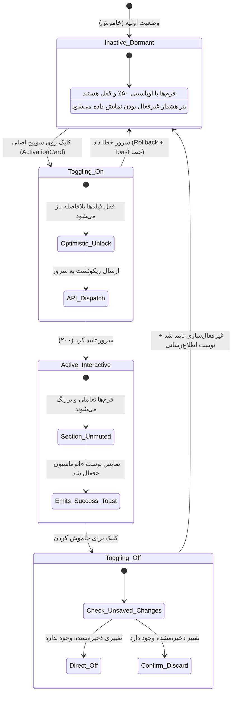
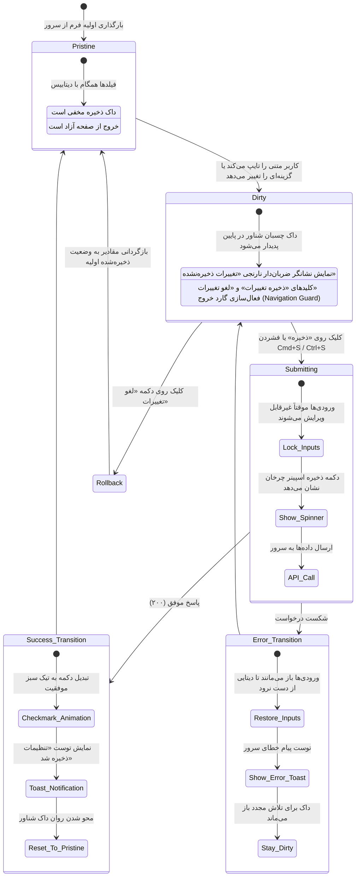
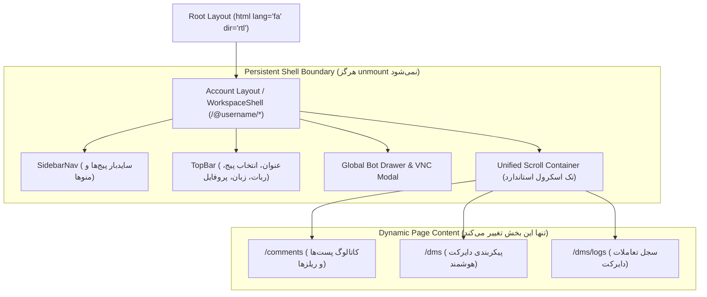

# Feature Specification: Unified Panel Architecture, Global UX Flows & Design System

**Feature Branch**: `012-unified-panel-architecture`

**Created**: 2026-10-20

**Status**: Draft (Amended with Exhaustive UX Flows & Brand Guidelines)

**Input**: User description: "ما در حال حاضر تو بحث کورکامپوننتهامون یکپارچگی رو داریم ولی توی معماریمون یکپارچگی رو توی پنل نداریم. یعنی اگر که ما یه شل در نظر بگیریم، تولبار یکسان، سایدنَو بغل یکسان باشه، از کامپوننتهای تو در تو به نظر استفاده نشده. کامپوننت پیجی، شلی، چیزی تعریف بشه و کامپوننتهای نویگیشن و کانتنت داخل اون استفاده بشه و انگار هر صفحهای برای خودش اینو یه جوری طراحی کرده و معماری کلان درستی روی دیزاین خروجی نداریم و اگر دقت کنی یه جاهایی اسکرول پیج سمت چپه، یه جایی سمت راسته. از این موضوع که بگذریم، توی یو ایکس و تعریف جزئیات، فلوهای فرمها، تاییدیه ها، اکتیو دیاکتیو کردن چیزی، اینها هم تعاریف درستی نداریم. الان قسمت دایرکت کاملاً با قسمت کامنت متفاوته. مثلاً اگر نگاه بکنی کارتی که برای فعال کردن اونه یه شکل دیگه است با مدلی که اون طرف توی دایرکت داریم و اینها هم به نظرم درست تعریف نشده. باید یو ایکس قوانینی داشته باشه که توی همه اینها بشه رعایت کرد. کانسپت کلی پنل مشخصه دیگه. تو میتونی از قوانینی که لازمه رو سِت بکنی. حتی توی متنها هم ما یکپارچگیهای درستی نداریم. اولا انگلیسی و فارسی و اینها یه جا انگلیسی فارسی استفاده شده، یه جا فارسی استفاده شده و هیچکدام از تکستها انگار اون یکپارچگیه رو نداره و لحنش متفاوته. این هم باید اصلاح بشه و ما روی لحن تایپومون یه چیزی داشته باشیم. فونتها بعضی جاها میبینی فارسی درست لود نشده و فونت اشتباهیه و بحث چند زبانه بودن هم کاملاً باید توی فایلهای جیسان تعریف بشه و همه کلیدها توی همه زبانها باشه و سعی کنه برای مفاهیمی که وسطش یه عبارت داینامیک هست، تکستهای داینامیکی استفاده بشه که بشه جایگذاری کرد. یه نکتهای که خیلی مهمه با توجه به اینکه ما اسپکدریون داریم توسعه میدیم باید توی مرحلهای مثل پلن یا تسک این رو کاملاً بپذیره که بره این معماریها رو دربیاره و یکپارچگی رو تو کل سیستم حفظ بکنه و برای خودش قواعد و قوانین خودش چه از نظر متن چه از نظر کامپوننت و یو ایکس کلی صفحه نذاره. دکمههای ذخیره در فرمها قانون و ساختار خودشو داشته باشه، پایین باشن، بالا باشن، چه شکلی باشن، یکدست باشن، تستش چی باشه، اصلا باید تست نمایش بده، دیالوگ نمایش بده، اینها همه قوانین بشن و اکتفا به همین پروژه هم نکنه. اگر لازمه یه سرچی بزن و یک قوانینی پیدا کن ببین اصلا سلسله قوانینی که باید تعریف کنی چیه و اونها رو به صورت گلوبال تعریف کن که در آینده هم مشکلی نخوری. بیشتر از اینکه ما کارتهای فعالسازی داشته باشیم و برای هر کاری کامپوننت داشته باشیم برام مهمه که به صورت کامل و با جزئیات از نظر ux ای فلو ها تعریف شده باشن و قوانینش مشخص باشه. داکیومنت های دقیق درباره معماری دیزاین، شناخت کامل برند و لحن، داک کاملی از ux سیستم با توجه به نیازمندی های فعلی و آینده."

---

## 1. Brand Identity, Design Architecture & Tone of Voice

### 1.1 Brand Persona: inFlow (شخصیت برند)
* **Archetype**: *The Intelligent Operator (دستیار هوشمند، متین، دقیق و کارآمد)*.
* **Core Brand Attributes**:
  - **Minimalist & Distraction-Free**: حذف کلیه تزئینات بصری اضافه، گرادیان‌های نئونی، تاری‌های اغراق‌آمیز (blur blobs) یا سایه‌های سنگین.
  - **Calm & Predictable**: سیستم هرگز کاربر را غافلگیر نمی‌کند؛ رفتار کلیدها، فلوهای ذخیره و جابجایی صفحات در تمام پنل قانون‌مند و یکسان است.
  - **Respectful & Authoritative**: با احترام به زمان و تمرکز کاربر سخن می‌گوید؛ اطلاعات پیچیده فنی (پراکسی، سشن، توکن) را در پشت صحنه مدیریت کرده و در نمای کاربری تجربه‌ای روان ارائه می‌دهد.
* **Official Visual System (shadcn/ui Light Mode Standard)**:
  - بوم کلی سیستم (`--background`): سفید خالص `#ffffff` و سطوح خنثی `#fafafa`.
  - کادرها و خطوط جداکننده (`--border`): زینک مات `#e4e4e7` (بدون خطوط پررنگ یا کدر).
  - المان‌های تاکیدی و اکشن‌های اصلی (`--primary`): زینک تیره و باوقار `#18181b`.
  - نشان‌های وضعیت (`Badges`): ملایم و پاستلی با لبه‌های نرم، متناسب با استانداردهای مدرن اینترپرایز.

### 1.2 Microcopy & Tone of Voice Handbook (دستورالعمل لحن و نگارش)
* **قاعده مخاطب قرار دادن**:
  - همواره از **دوم‌شخص محترمانه و جمع** («شما»، «خدمتتان») استفاده می‌شود.
  - از عبارات عامیانه («دمت گرم»، «اوکی شد») یا جملات ماشینی و بی‌روح («فرایند ذخیره‌سازی با موفقیت پایان پذیرفت») پرهیز می‌شود.
* **پرهیز از ترکیب‌های نامأنوس انگلیسی-فارسی**:
  - عباراتی نظیر «اکشن پاسخ به کامنت (Comment Reply)» یا «ست کردن تریگر در پنل» کاملاً ممنوع است.
  - اصطلاح اصلی فارسی روان است و در صورت نیاز فنی، واژه لاتین به‌صورت نشان کوچک یا زیرنویس خاکستری می‌آید.
* **فرهنگ واژگان رسمی پلتفرم (Terminology Dictionary)**:

| مفهوم لاتین | واژه استاندارد فارسی (تکست اصلی) | برچسب کمکی (اختیاری) | تعریف و کاربرد در پنل |
| :--- | :--- | :--- | :--- |
| **Comment Automation** | پاسخ خودکار کامنت | Auto-Reply | اتوماسیون پاسخگویی به نظرات عمومی کاربران زیر پست‌ها |
| **Direct Message / DMs** | دایرکت هوشمند | Direct | اتوماسیون ارسال پیام خصوصی و پاسخ به پیام‌های دریافتی |
| **Trigger** | شرط فعال‌سازی | Trigger | رویداد یا شرطی که پردازش کامنت یا دایرکت را آغاز می‌کند |
| **Follow Gate** | شرط دنبال کردن پیج | Follow Gate | پیش‌شرط فالو داشتن پیج برای دریافت پاسخ یا کاتالوگ در دایرکت |
| **AI Prompt Instructions** | دستورالعمل هوش مصنوعی | AI Context | راهنمای کانتکس و لحن ایجنت برای تولید متن هوشمند |
| **Direct Reply** | پاسخ مستقیم و ثابت | Direct Text | ارسال یک متن از پیش تعیین‌شده و ثابت |
| **Save Changes** | ذخیره تغییرات | Save | دکمه ثبت فرم در داک شناور پایین صفحه |
| **Cancel Changes** | لغو تغییرات | Cancel / Reset | بازگردانی فیلدهای ویرایش‌شده به مقادیر قبلی سرور |
| **Workspace Shell** | شل پیشخوان پیج | Workspace | اسکلت پایدار شامل سایدبار، نوار بالا و کانتینر محتوا |
| **Bot Screen / VNC** | مانیتور زنده ربات | Bot Screen | پنجره اتصال مستقیم امن به مرورگر ربات اختصاصی |
| **Key Parity** | یکپارچگی کلیدهای ترجمه | Parity | حضور ۱۰۰٪ کلیدها در هر ۳ فایل `fa.json`، `en.json` و `ar.json` |

---

## 2. Exhaustive UX Flows & Interaction Architecture

### 2.1 UX Flow 1: Feature Enablement & Progressive Disclosure (فلو فعال‌سازی و آشکارسازی تدریجی)

این فلو رفتار تمام کلیدهای روشن/خاموش کردن ویژگی‌ها در پنل (نظیر اتوماسیون کامنت، دایرکت هوشمند، شرط فالو و پلاگین‌های آینده) را یکپارچه می‌کند:



#### گام‌های اجرایی و قوانین UX:
1. **کارت فعال‌سازی واحد (`ActivationCard`)**:
   - در بالای هر صفحه تنظیمی قرار می‌گیرد.
   - شامل آیکون نمادین، عنوان پررنگ، برچسب پاستلی (`روشن` با رنگ سبز زمردی یا `خاموش` با زینک)، ساب‌تایتل توضیحی دومرحله‌ای، و سوییچ اصلی در انتهای ردیف.
2. **قاعده آشکارسازی تدریجی (Progressive Disclosure)**:
   - هنگامی که ویژگی **خاموش** است: کلیه بخش‌های پیکربندی زیرین با اوپاسیتی ۵۰٪ نمایش یافته و `pointer-events-none` می‌شوند. یک بنر ظریف با پیام «این قابلیت خاموش است؛ برای فعال‌سازی و پاسخگویی به کاربران، کلید بالا را روشن کنید» در بالای تنظیمات ظاهر می‌شود.
   - هنگامی که ویژگی **روشن** می‌شود: فیلدها بی‌درنگ فعال شده، بنر ناپدید گشته و کاربر به سرعت به فیلدها دسترسی می‌یابد.
3. **به‌روزرسانی خوش‌بینانه (Optimistic Update)**:
   - سوییچ فعال‌سازی بلافاصله در UI وضعیت جدید را منعکس می‌کند تا کاربر احساس وقفه نکند. در صورت شکست اتصال، وضعیت به حالت قبلی بازمی‌گردد و توست خطا نمایش داده می‌شود.

---

### 2.2 UX Flow 2: Form Modification, Dirty State & The Sticky Save Dock (فلو تغییرات فرم و داک ذخیره چسبان)

هیچ دکمه ذخیره‌ای نباید به صورت سردرگم در انتهای کارت‌ها یا بالای صفحات پراکنده باشد. تمام فرم‌های سامانه تابع قرارداد وضعیت زیر هستند:



#### سناریوی خروج با تغییرات ذخیره‌نشده (Dirty Navigation Interception):
1. **تغییر مسیر درون‌برنامه‌ای (کلیک روی سایدبار، تب‌ها یا پیج دیگر)**:
   - رویداد ناوبری بلافاصله متوقف می‌شود.
   - پنجره هشدار یکپارچه (`UnsavedChangesModal`) باز می‌شود:
     - *عنوان*: «تغییرات ذخیره‌نشده دارید»
     - *متن*: «در صورت ترک این صفحه، تغییراتی که اعمال کرده‌اید ذخیره نخواهند شد. آیا مطمئنید؟»
     - *اکشن ثانویه*: «ماندن در صفحه و ادامه ویرایش» (تمرکز اولیه روی این دکمه است).
     - *اکشن اصلی تخریبی*: «خروج بدون ذخیره» (تغییرات را لغو کرده و کاربر را هدایت می‌کند).
2. **بستن تب مرورگر یا رفرش (`Cmd+R` / `F5`)**:
   - لیسنر `beforeunload` مرورگر به صورت خودکار فعال شده و از بسته شدن ناخواسته تب جلوگیری می‌کند.

---

### 2.3 UX Flow 3: Workspace Shell & Zero-Flash Tab Switching (فلو شل پیشخوان و جابجایی تب‌ها)

معماری ساختاری صفحه به صورت سلسله‌مراتبی و تودرتو (Nested Layout) طبق قرارداد زیر پیاده‌سازی می‌شود:



#### مزایای حیاتی این فلو برای UX:
1. **صفر ثانیه زمان لود مجدد ناوبری**: سایدبار و نوار بالا حتی ۱ میلی‌ثانیه فلاش یا لودینگ مجدد نمی‌خورند.
2. **عدم از دست رفتن وضعیت محلی**: اگر منوی کشویی در سایدبار باز است یا کاربر کشوی مانیتورینگ ربات را باز کرده، تغییر صفحه باعث بسته شدن ناگهانی آن نمی‌شود.
3. **ساختار اسکرول واحد (Single Scroll Container)**:
   - کل صفحه پیشخوان از یک کانتینر اسکرول استاندارد عمودی بهره می‌برد.
   - اسکرول پنجره (Window) قفل شده و محتوای درون کانتینر اسکرول می‌خورد.
   - اسکرول‌بار در حالت فارسی و عربی (`dir="rtl"`) دقیقاً در **سمت چپ کانتینر محتوا** و در حالت انگلیسی (`dir="ltr"`) در **سمت راست** قرار می‌گیرد؛ بدون هیچ‌گونه تداخل با اسکرول بادی یا پرش‌های ناگهانی.

---

### 2.4 UX Flow 4: Unified Feedback & Notification Hierarchy (ماتریس بازخورد و اعلان‌ها)

سیستم از سلسله‌مراتب ۵ سطحی شفاف برای آگاه‌سازی کاربر استفاده می‌کند تا هیچ پیامی نابجا نمایش داده نشود:

| سطح بازخورد | المان بصری | نوع رخداد و کاربرد | رفتار و زمان نمایش | مثال عملی در پنل |
| :--- | :--- | :--- | :--- | :--- |
| **سطح ۱: فیلد** | Inline Helper / Error | خطای اعتبارسنجی ورودی فرم | قرمز ملایم زیر اینپوت به همراه آیکون اخطار | «لطفاً حداقل یک کلمه کلیدی وارد کنید» |
| **سطح ۲: تعاملی** | Sticky Save Dock | اعلان وجود تغییرات ذخیره‌نشده | چسبان شناور در پایین صفحه تا زمان ذخیره یا لغو | «۲ تغییر ذخیره‌نشده دارید [ذخیره] [لغو]» |
| **سطح ۳: سیستمی** | Global Toast (Sonner) | تایید عملیات‌های ناهمگام سرور | گوشه صفحه (پایین سمت چپ در RTL) با تایم‌اوت ۴ ثانیه | «تنظیمات دایرکت هوشمند با موفقیت ذخیره شد» |
| **سطح ۴: تمرکزی** | Modal Dialog | کارهای متمرکز چندمرحله‌ای | پوشش مات تیره، بستن با کلید Esc یا کلیک بیرون | لاگ‌های یک پست، اتصال API، مانیتور VNC |
| **سطح ۵: تخریبی** | Destructive Confirm | اقدامات غیرقابل بازگشت | تایید دو مرحله‌ای با دکمه قرمز و متن بازدارنده | «آیا از حذف حساب و توقف کامل ربات اطمینان دارید؟» |

---

### 2.5 UX Flow 5: Centralized Multi-Language JSON Architecture (معماری چندزبانه JSON)

سیستم تمام رشته‌های رابط کاربری را از شیء کدهای تایپ‌اسکریپت به ساختار استاندارد فایل‌های JSON منتقل می‌کند:

```
src/
└── locales/
    ├── fa.json   # دیکشنری کامل مرجع فارسی
    ├── en.json   # دیکشنری کامل انگلیسی (با رعایت اصطلاحات SaaS)
    └── ar.json   # دیکشنری کامل عربی استاندارد
```

#### قرارداد درون‌یابی داینامیک متغیرها (Dynamic Parameter Interpolation):
متن‌هایی که حاوی مقادیر متغیر هستند با نشان استاندارد `{paramName}` فرمت‌بندی می‌شوند:
- نمونه فارسی: `"commentCount": "{count} نظر برای پست {shortcode} ثبت شده است"`
- نمونه انگلیسی: `"commentCount": "{count} comments registered for post {shortcode}"`
- نمونه عربی: `"commentCount": "تم تسجيل {count} تعليق للمنشور {shortcode}"`

فراخوانی در کامپوننت‌ها به شکل تایپ‌سیف و روان:
`t("commentCount", { count: 48, shortcode: "DehQhnjoEcr" })`

---

## 3. User Scenarios & Acceptance Testing *(mandatory)*

### User Story 1 - Unified Workspace Shell & Cohesive Navigation (Priority: P1)
**Given** an authenticated user on `/@r9spoort1/comments`,  
**When** the user clicks on the `DMs` navigation item in the sidebar,  
**Then** the route switches instantly to `/@r9spoort1/dms`, the sidebar and top toolbar do not remount or flicker, and the main viewport displays the DM configuration.

### User Story 2 - Universal Activation Card & Form Progressive Disclosure (Priority: P1)
**Given** a deactivated automation view (Comments or DMs),  
**When** the user toggles the master switch on the `ActivationCard`,  
**Then** the card updates its badge to `روشن`, child form sections become fully interactive without opacity muting, and a success toast is presented.

### User Story 3 - Sticky Save Bar & Keyboard Shortcuts (Priority: P1)
**Given** an active configuration form,  
**When** the user edits a prompt or changes trigger options,  
**Then** the Sticky Save Dock slides up from the bottom showing `ذخیره تغییرات` and `لغو تغییرات`. Pressing `Cmd+S` or `Ctrl+S` saves the form, shows a spinner, transitions to a checkmark, and smoothly dismisses the dock.

### User Story 4 - Unsaved Changes Navigation Interception (Priority: P1)
**Given** a form in the `Dirty` state,  
**When** the user attempts to click another navigation link or switch accounts,  
**Then** the transition is paused and a confirmation dialog asks the user whether to discard changes or stay on the page.

### User Story 5 - Full JSON Locale Parity & Dynamic Interpolation (Priority: P2)
**Given** the multi-language subsystem,  
**When** a key with dynamic tokens `{username}` and `{count}` is requested,  
**Then** it formats cleanly in Persian, English, and Arabic, and automated verification guarantees 0% missing keys across `fa.json`, `en.json`, and `ar.json`.

### User Story 6 - Predictable Single Scrollbar & Global Vazirmatn Font (Priority: P2)
**Given** any dashboard view in Persian or Arabic,  
**When** the user scrolls through long lists or forms,  
**Then** exactly one sleek vertical scrollbar renders on the left edge, and all text elements render using the `Vazirmatn` font family.

---

## 4. Functional Requirements

- **FR-001**: System MUST provide a persistent `WorkspaceShell` via Next.js App Router nested layout (`src/app/[account]/layout.tsx`) hosting `SidebarNav`, TopBar, and global bot modals.
- **FR-002**: Sub-page navigation between `comments`, `dms`, and `logs` MUST execute without remounting the `SidebarNav` or top toolbar.
- **FR-003**: System MUST enforce a single primary vertical scroll container per workspace, with zero nested window/container scrollbar collisions.
- **FR-004**: Scrollbar position MUST strictly adhere to document direction: left edge for RTL (`fa`, `ar`) and right edge for LTR (`en`).
- **FR-005**: All automation modules (Comments, DMs, future plugins) MUST utilize the universal `ActivationCard` component.
- **FR-006**: When an automation is turned OFF, dependent configuration controls MUST be visually muted (opacity 50%, non-interactive) with an informative alert banner.
- **FR-007**: All configuration forms MUST adhere to the universal Form State lifecycle (`Pristine`, `Dirty`, `Submitting`, `Success`, `Error`).
- **FR-008**: When a form is `Dirty`, a standardized `StickySaveBar` MUST surface at the bottom of the viewport with dirty rule count, reset action, and save action.
- **FR-009**: The form save action MUST be triggerable via `Cmd+S` (macOS) and `Ctrl+S` (Windows/Linux).
- **FR-010**: System MUST intercept in-app route changes and tab closures (`beforeunload`) when a form has unsaved dirty changes, requiring user confirmation.
- **FR-011**: All ad-hoc toast/alert states across views MUST be replaced with a single global Toast provider (`sonner`) with native RTL and Vazirmatn support.
- **FR-012**: Destructive actions (deleting accounts, clearing logs, resetting rules) MUST be guarded by the universal `ConfirmDialog` primitive.
- **FR-013**: All user-facing strings MUST be migrated from TypeScript objects to `src/locales/{fa,en,ar}.json`.
- **FR-014**: The i18n helper MUST support parameterized string interpolation formatted as `{paramName}`.
- **FR-015**: 100% key parity MUST be maintained across `fa.json`, `en.json`, and `ar.json`, verified by a test script.
- **FR-016**: Typography MUST reliably apply `Vazirmatn` across all UI elements, inputs, and buttons in RTL locales; undefined `font-vazir` classes MUST be removed.
- **FR-017**: Bidirectional isolation (`<bdi>`) MUST wrap technical tokens, handles (`@username`), and English acronyms (`AI`, `DM`, `MCP`, `API`) within Persian copy.
- **FR-018**: Microcopy across the entire application MUST adhere to the codified Tone of Voice handbook and Terminology Dictionary.

---

## 5. Success Criteria

- **SC-001**: 100% of workspace routes (`/@{account}/*`) use the unified `WorkspaceShell`, with 0 unnecessary remounts during sub-navigation.
- **SC-002**: 100% of configuration forms adhere to the `ActivationCard` + `StickySaveBar` contract, providing a unified save and toggle experience across Comments and DMs.
- **SC-003**: 100% of UI strings are served from structured JSON files (`fa.json`, `en.json`, `ar.json`) with zero missing translation keys.
- **SC-004**: Zero instances of double vertical scrollbars or conflicting left/right scrollbar hopping across all views.
- **SC-005**: 100% of Persian and Arabic text renders in `Vazirmatn` with directional punctuation stability.
- **SC-006**: Form dirty states consistently display the bottom dock, intercept unsaved navigation, and respond to `Cmd+S` / `Ctrl+S` keyboard shortcuts.

---

## 6. Assumptions

- Nested layout routing in Next.js 16 App Router (`src/app/[account]/layout.tsx`) will be utilized for the shell boundary.
- Database schemas for `posts`, `dm_automations`, and `accounts` are fully preserved without breaking migrations.
- `sonner` is utilized for unified, accessible, and lightweight toast notifications.
- Localized JSON files will be loaded synchronously or statically bundled to ensure zero-flash translation rendering.
