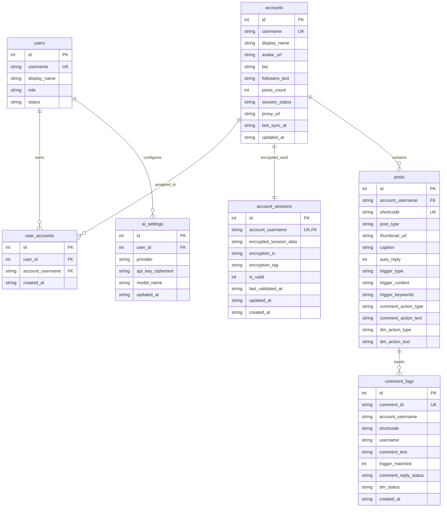
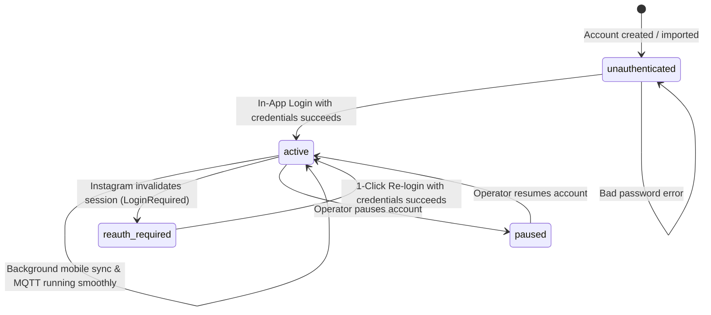

# Data Model: Direct Native Instagram Integration & Zero-Password Session Vault

**Feature**: `014-native-instagram-engine`  
**Date**: 2026-10-21 (Updated)  
**Status**: Completed

---

## 1. Entity-Relationship Diagram

---

## 2. Table Schemas & Constraints

### 2.1 Refactored Table: `accounts` (Zero-Bot Schema)

Retires all legacy bot/VNC fields (`bot_status`, `bot_vnc_active`, `bot_vnc_token`, etc.) in favor of clean session health indicators:

| Column | Type | Constraints | Description |
| :--- | :--- | :--- | :--- |
| `id` | `INTEGER` | `PRIMARY KEY AUTOINCREMENT` | Account record ID |
| `username` | `TEXT` | `UNIQUE NOT NULL` | Instagram username handle (e.g. `mahdiketabdar`) |
| `display_name` | `TEXT` | `NULL` | Full name on Instagram profile |
| `avatar_url` | `TEXT` | `NULL` | Profile picture CDN URL |
| `bio` | `TEXT` | `NULL` | Account biography |
| `followers_text`| `TEXT` | `NULL` | Formatted follower count (e.g. `511`) |
| `posts_count` | `INTEGER` | `DEFAULT 0` | Total posts count |
| `session_status`| `TEXT` | `NOT NULL DEFAULT 'unauthenticated'` | `unauthenticated` \| `active` \| `reauth_required` \| `paused` \| `error` |
| `proxy_url` | `TEXT` | `NULL` | Optional SOCKS5 or HTTP proxy URL |
| `last_sync_at` | `TEXT` | `NULL` | Timestamp of last successful API sync/poll |
| `updated_at` | `TEXT` | `NOT NULL` | ISO timestamp of record update |
| `created_at` | `TEXT` | `NOT NULL` | ISO timestamp of record creation |

---

### 2.2 Table: `account_sessions` (Zero-Password Encrypted Vault)

| Column | Type | Constraints | Description |
| :--- | :--- | :--- | :--- |
| `id` | `INTEGER` | `PRIMARY KEY AUTOINCREMENT` | Session vault ID |
| `account_username` | `TEXT` | `UNIQUE NOT NULL REFERENCES accounts(username) ON DELETE CASCADE` | Associated Instagram account |
| `encrypted_session_data`| `TEXT` | `NOT NULL` | AES-256-GCM ciphertext of settings (cookies, UUIDs, tokens) |
| `encryption_iv` | `TEXT` | `NOT NULL` | 12-byte initialization vector |
| `encryption_tag` | `TEXT` | `NOT NULL` | 16-byte authentication tag |
| `is_valid` | `INTEGER` | `NOT NULL DEFAULT 1` | `1` if session is working; `0` if expired |
| `last_validated_at` | `TEXT` | `NULL` | Last verification timestamp |
| `updated_at` | `TEXT` | `NOT NULL` | Timestamp |
| `created_at` | `TEXT` | `NOT NULL` | Timestamp |

---

### 2.3 New Table: `ai_settings` (Direct API Key Configuration)

| Column | Type | Constraints | Description |
| :--- | :--- | :--- | :--- |
| `id` | `INTEGER` | `PRIMARY KEY AUTOINCREMENT` | Settings ID |
| `user_id` | `INTEGER` | `NOT NULL REFERENCES users(id)` | Tenant owner |
| `provider` | `TEXT` | `NOT NULL DEFAULT 'openai'` | `'openai'` \| `'gemini'` \| `'anthropic'` |
| `api_key_ciphertext` | `TEXT` | `NOT NULL` | Encrypted API key |
| `model_name` | `TEXT` | `NOT NULL DEFAULT 'gpt-4o-mini'` | LLM model identifier |
| `updated_at` | `TEXT` | `NOT NULL` | Timestamp |

---

## 3. Session Status Lifecycle

