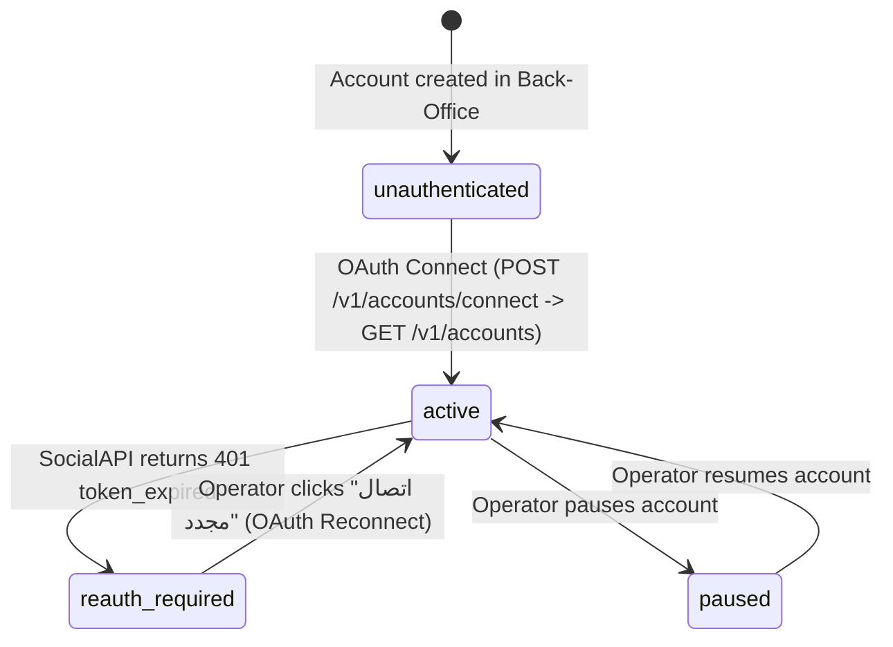

# Phase 1 Data Model: Unified SocialAPI.ai Instagram Integration

**Feature**: `015-social-api-instagram-migration`  
**Database**: SQLite (`data/inflow.db` via `better-sqlite3`, WAL mode)

---

## 1. Schema Modifications & Cleanup

### 1.1 `accounts` Table (Updated)
Stores Instagram accounts managed in inFlow and their mapping to SocialAPI.ai `account_id` (`acc_...`).

| Column | Type | Constraints | Description |
| :--- | :--- | :--- | :--- |
| `id` | `INTEGER` | `PRIMARY KEY AUTOINCREMENT` | Internal numeric ID |
| `username` | `TEXT` | `UNIQUE NOT NULL` | Instagram handle (lowercase, without `@`) |
| `social_account_id` | `TEXT` | `DEFAULT NULL` | SocialAPI.ai identifier (e.g., `acc_01HZ9X3Q4R5M6N7P8V2K0W1J`) |
| `display_name` | `TEXT` | `NOT NULL DEFAULT ''` | Account display name |
| `avatar_url` | `TEXT` | `NOT NULL DEFAULT ''` | Profile picture URL |
| `bio` | `TEXT` | `NOT NULL DEFAULT ''` | Biography text |
| `followers_text` | `TEXT` | `DEFAULT NULL` | Formatted follower count |
| `posts_count` | `INTEGER` | `DEFAULT 0` | Number of synchronized posts |
| `status` | `TEXT` | `NOT NULL DEFAULT 'active'` | `'active'` \| `'paused'` |
| `session_status` | `TEXT` | `NOT NULL DEFAULT 'unauthenticated'` | `'unauthenticated'` \| `'active'` \| `'reauth_required'` \| `'paused'` \| `'error'` |
| `last_sync_at` | `TEXT` | `DEFAULT NULL` | Timestamp of last SocialAPI sync |
| `last_heartbeat_at` | `TEXT` | `DEFAULT NULL` | Timestamp of last webhook or sync event |
| `updated_at` | `TEXT` | `NOT NULL` | Last update timestamp |
| `created_at` | `TEXT` | `NOT NULL` | Creation timestamp |

*Migration Note*: Add `social_account_id TEXT DEFAULT NULL` via idempotent `ALTER TABLE accounts ADD COLUMN social_account_id TEXT DEFAULT NULL` in `migrateSchema()`. Drop legacy table `account_sessions` (`DROP TABLE IF EXISTS account_sessions;`) so zero encrypted cookie blobs remain.

---

### 1.2 `app_settings` Table (Platform Credentials)
Stores centralized Back-Office keys (never exposed to tenants):

| Key | Value Format | Description |
| :--- | :--- | :--- |
| `social_api_key` | `sapi_key_...` | SocialAPI.ai Bearer API Key |
| `social_api_base_url` | `https://api.social-api.ai` | Base URL for SocialAPI.ai |
| `social_webhook_secret` | `whsec_...` | Signing secret for `X-SocialAPI-Signature` verification |
| `social_webhook_id` | `wh_...` | Registered webhook endpoint ID in SocialAPI.ai |
| `ai_provider` | `'gemini'` \| `'openai'` | Active AI provider for `ai_context` triggers |
| `ai_api_key` | `AIza...` / `sk-...` | AI provider API key |
| `ai_model` | `gemini-1.5-flash` / `gpt-4o-mini` | Selected LLM model |

---

### 1.3 `posts` Table (1-to-1 Post / Reel Mapping)
* `shortcode` (`TEXT UNIQUE NOT NULL`) — Instagram post code or normalized SocialAPI post identifier.
* `media_id` (`TEXT NOT NULL DEFAULT ''`) — Remote SocialAPI / Instagram `postId` (e.g., `17895695668004550` or `p_01HZ...`) used when calling `/v1/inbox/comments/{postId}`.
* Automation columns (`auto_reply`, `trigger_type`, `trigger_context`, `trigger_keywords`, `comment_action_type`, `comment_action_text`, `dm_action_type`, `dm_action_text`, `dm_require_follow`) remain unchanged.

---

### 1.4 `comment_logs` & `dm_logs` Tables (Idempotency Locks)
* `comment_logs.comment_id` (`TEXT UNIQUE NOT NULL`) — Guarantees each comment from `comment.received` webhook or `/v1/inbox/comments/{postId}` is processed at most once.
* `dm_logs.message_id` (`TEXT UNIQUE NOT NULL`) — Guarantees each incoming DM from `dm.received` webhook or `/v1/inbox/conversations` is processed at most once.

---

## 2. Account Connection State Machine

