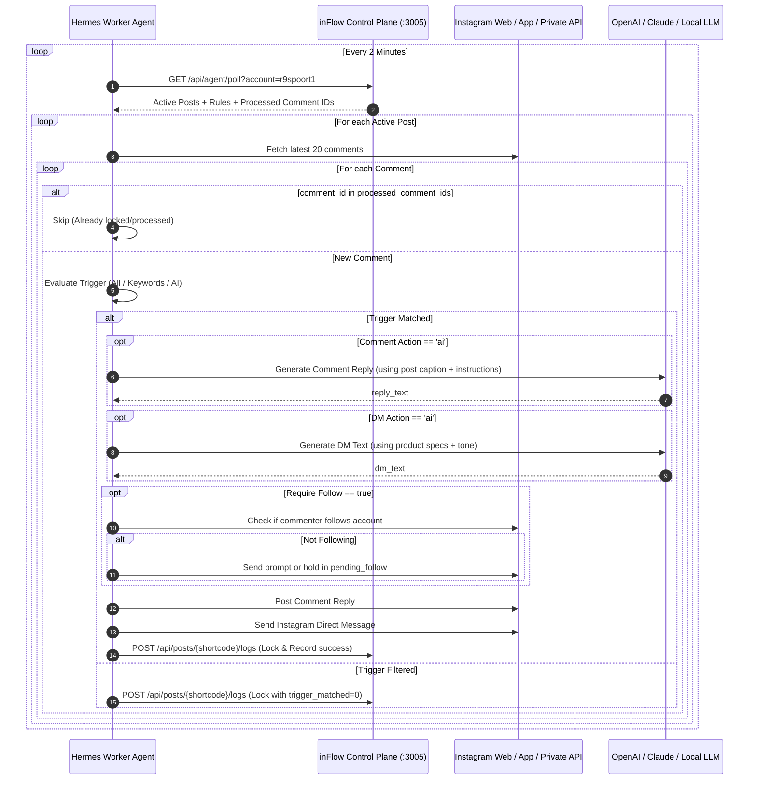

# Hermes Agent Integration Protocol

This document provides the technical specification for implementing the **Execution Plane (Hermes Agent / Python Worker)** that connects to `inFlow Control Plane`.

---

## 1. Execution Flow & Lifecycle (Every 2 Minutes)



---

## 2. Trigger Evaluation Logic

### 1. `all` (All Comments)
* Every new comment matches: `trigger_matched = 1`.

### 2. `keywords` (Keywords Matching)
* Comma-separated keyword list (e.g. `قیمت, لینک, سایز, چند, تخفیف`).
* Normalize comment text (lowercase, remove diacritics).
* If any keyword is found in `comment_text`: `trigger_matched = 1`.

### 3. `ai_context` (Semantic AI Filter)
* Prompt template for LLM evaluation:
```markdown
System: You are an intent classifier for Instagram comments.
Post Caption: {caption}
Condition: {trigger_context}
Comment: "{comment_text}"

Does this comment express interest or intent matching the condition?
Respond with JSON: {"matched": true|false, "reason": "brief explanation"}
```

---

## 3. Dynamic AI Response Generation Prompts

When `comment_action_type === 'ai'` or `dm_action_type === 'ai'`:

### Comment Reply Prompt
```markdown
System: You are a friendly, professional social media manager for @{account_username}.
Post Caption: {caption}
Instructions: {comment_action_text}
User Comment: "{comment_text}"

Write a concise public comment reply (1-2 sentences). Do not mention prices publicly if instructed to direct them to DM. Use friendly emojis.
```

### Direct Message (DM) Prompt
```markdown
System: You are an automated sales assistant for @{account_username}.
Post Caption: {caption}
Product & Pricing Details: {dm_action_text}
User Name: @{commenter_username}
User Question: "{comment_text}"

Formulate a warm, polite, and detailed direct message with all pricing, sizing, ordering instructions, and links as specified.
```

---

## 4. Idempotency & Concurrency Locking Contract

To ensure that network latency or agent retries never result in duplicate messages:
1. Always send `comment_id` in `POST /api/posts/{shortcode}/logs`.
2. If `inFlow` responds with `"already_processed": true`, abort any further action on that comment.
3. The database schema enforces `UNIQUE(comment_id)`.
